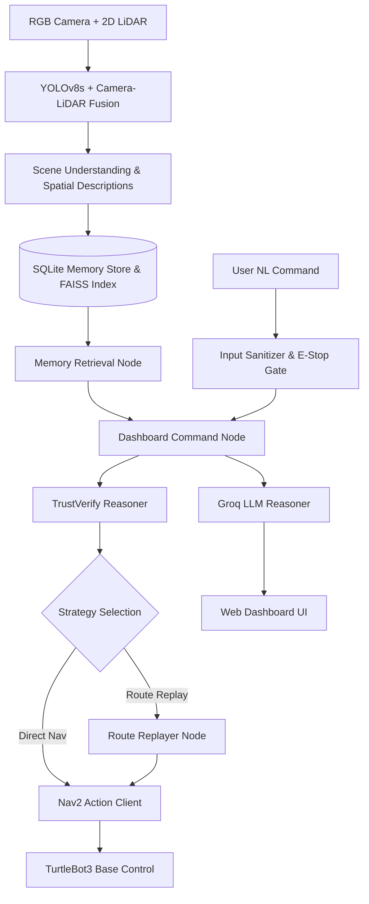

# AEMS System Architecture

## 1. High-Level Architectural Overview

The Adaptive Episodic Memory System (AEMS) is organized into four primary functional layers:
1. **Perception & Spatial Understanding Layer:** Fuses camera RGB streams with 2D LiDAR scans, identifies objects using YOLOv8s, calculates 3D metric coordinates, and generates spatial relations and text scene descriptions.
2. **Episodic Memory & Retrieval Layer:** Manages persistent SQLite episodic storage, updates topometric landmark graphs, and performs FAISS dense semantic indexing and multi-criteria episode scoring.
3. **Decision & Strategy Reasoning Layer:** Evaluates trust-vs-verify decision math, selects navigation strategies (Direct Navigation vs. Landmark Route Replay), executes wall-clearing standoff planning, and performs Multi-Room Perimeter Scouting.
4. **Interface & Safety Layer:** Provides web WebSocket bridging, natural-language query grounding with Groq LLM, software E-Stop gating, input sanitization, and structured audit logging.

---

## 2. Component Specifications

### 2.1 Perception & Scene Understanding
- **Nodes:** `yolo_perception_node.py`
- **Model:** YOLOv8s pretrained on COCO (classes: chair, couch, dining table, car, person, fire hydrant)
- **Sensor Fusion:** Camera bearing angles are fused with minimum LiDAR radial distance within bearing cone.
- **Scene Descriptions:** Relative positions of detected objects to robot and nearby landmarks generate descriptive summaries (e.g., `"couch near landmark entrance, 2.3m north-west"`).

### 2.2 Memory Store & FAISS Indexing
- **Database:** `~/aems_ws/aems_memory.db` (SQLite 3 with WAL mode)
- **Primary Tables:**
  - `landmarks`: Topological anchor points with coordinates and perceptual signatures.
  - `landmark_edges`: Graph connectivity between landmarks.
  - `object_sightings`: Episodic sighting records including robot pose, task info, scene descriptions, and binary vector embeddings.
  - `task_history`: Audit records for every user command, strategy, outcome, duration, and goal coordinates.
  - `system_events`: Audit log of system state transitions, E-Stop triggers, and fallback events.
- **Semantic Retrieval (`retrieval.py`):**
  - Model: `sentence-transformers/all-MiniLM-L6-v2` (384-dimensional dense vectors).
  - Index: `faiss.IndexFlatIP` (Cosine similarity over L2-normalized embeddings).
  - Latency: Hardware-verified 12.65 ms across 10,000 synthetic records.

### 2.3 Trust-vs-Verify & Cost Reasoning
- **Module:** `trust_verify.py`
- **Cost Formulation (Protected Mathematical Formulation):**
  - Probability of validity: $p_{valid} = \text{confidence} \times e^{-\lambda \cdot \Delta t} \times \min(1.0, 0.5 + 0.25 \times (\text{corroboration} - 1))$
  - Expected cost of trusting:
    $$C_{trust} = 8.0 + (1.0 - p_{valid}) \times 40.0$$
  - Expected cost of reverifying:
    $$C_{reverify} = 12.0 + 8.0 \times 0.6$$
  - Cost of full exploration: $C_{explore} = 40.0$
- **Decision Rule:**
  - If $C_{trust} \le C_{reverify} \le C_{explore}$: Choose **Direct Trust**.
  - If $C_{reverify} < C_{trust}$: Choose **Reverify**.
  - If both exceed exploration threshold: Choose **Scout / Full Exploration**.

### 2.4 Navigation & Obstacle-Aware Standoff
- **Wall Clearing:** Given object position $(x_{obj}, y_{obj})$, evaluates radial standoff candidates and verifies ray clearance against known interior walls (`iw_1` through `iw_4`).
- **Autonomous Multi-Room Perimeter Scout:** If the target object is occluded behind interior partition walls upon arrival, systematically generates vantage waypoints around wall perimeters until visual confirmation occurs.
- **Route-Replay Fallback:** If landmark route replay times out (45s deadline) or Nav2 fails, cleanly falls back to direct navigation.

---

## 3. Communication Architecture

- **ROS 2 Middleware:** FastDDS / CycloneDDS on ROS 2 Jazzy.
- **Dashboard Web Bridge (`aems_web_bridge.py`):**
  - Runs an asynchronous WebSocket server on port `9090`.
  - Broadcasts periodic `db_snapshot` every 3 seconds containing active memories, landmarks, edges, and task history.
